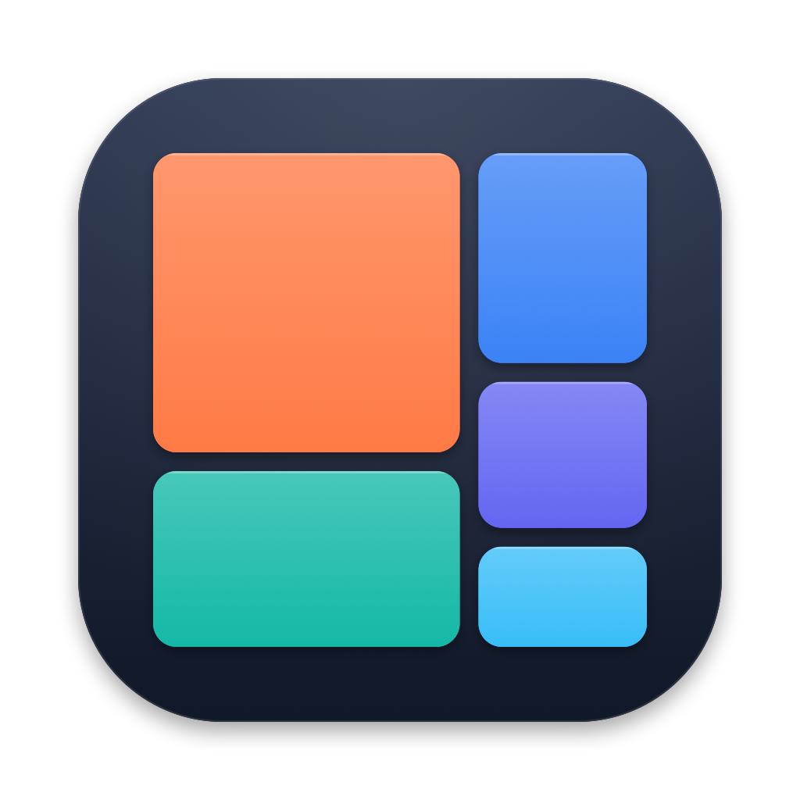

<p align="center"></p>

# MacSize

A fast, native disk-usage analyzer for macOS, inspired by TreeSize. It comes as
a SwiftUI desktop app and a command-line tool (`macsize`), both built on the same scanner engine.

- **Fast scanning.** Uses `getattrlistbulk(2)` to read many directory entries per
  syscall, with a pool of worker threads walking the tree in parallel. It's typically 3–4×
  faster than `du` on large folders.
- **Correct sizes.** Reports *size on disk* (allocated blocks) by default, so APFS
  compression, sparse files and clones are counted the way `du` counts them. Hard links are
  counted once. Switch to *logical size* at any time.
- **Treemap.** A nested treemap. Click to select, double-click to zoom in, and use the
  breadcrumb bar to zoom out.
- **Finder actions.** Reveal in Finder, Open, Copy Path, and Move to Trash (with confirmation).
- **CLI.** Size-sorted trees, largest files, per-extension summaries, JSON output, and a
  benchmark against `du`.

---

## Quick start: run it on your Mac

### Option A: download the app (recommended)

1. Download the latest **`MacSize-<version>.dmg`** from
   [Releases](https://github.com/lurking-walrus/treesize-mac/releases/latest).
2. Open it and drag **MacSize** into **Applications**.
3. Open MacSize. It's signed and notarized by Apple, so it opens without warnings.

MacSize updates itself: it checks daily, downloads in the background and installs when you
quit. You can also choose **MacSize › Check for Updates…**. Then continue with
[step 4](#4-optional-install-the-command-line-tool) and [step 5](#5-grant-full-disk-access-recommended).

### Option B: build from source

Building from source gives you **MacSize Dev**, which is separate from the official app. It
has its own name and bundle ID (`com.example.macsize.dev`), so it shows up as "MacSize Dev"
in Full Disk Access, the Dock and Finder. It can sit next to an installed MacSize without
mixing up their settings or permissions. Dev builds never auto-update.

#### 1. Check that you have the requirements

- **macOS 14 (Sonoma) or later.** Check this under Apple menu › About This Mac.
- **Xcode 16 or later**, installed from the [App Store](https://apps.apple.com/app/xcode/id497799835).
  Open Xcode once after installing so it can finish setting up, then make it the active toolchain:

  ```bash
  sudo xcode-select --switch /Applications/Xcode.app/Contents/Developer
  ```

  Confirm Swift 6 or newer is available:

  ```bash
  swift --version
  ```

  The Xcode Command Line Tools alone (`xcode-select --install`) are usually enough to build
  the app and CLI. The full Xcode install is the reliable option, and it's needed for `swift test`.

#### 2. Get the code

```bash
git clone https://github.com/lurking-walrus/treesize-mac.git
```

```bash
cd treesize-mac
```

#### 3. Build and open the app

```bash
scripts/build-app.sh
```

```bash
open "build/MacSize Dev.app"
```

The app opens on a welcome screen. Choose **Home Folder**, a volume, or **Choose Folder…** (⌘O).

To keep it, copy it into your `Applications` folder:

```bash
cp -R "build/MacSize Dev.app" /Applications/
```

### 4. (Optional) Install the command-line tool

**From the app (easiest):** the welcome screen has a **Command-Line Tool** card that shows
whether `macsize` is installed and where. Click **Install**:

- **For All Users** links `/usr/local/bin/macsize`. macOS asks for your password.
- **Just for Me** links `~/.local/bin/macsize`. No password is needed.

The command is a link to the copy inside the app, so it updates whenever the app does.
The card also offers **Update**, **Repair** (if the app was moved) and **Uninstall**.

**From Terminal:** this installs a standalone copy into `~/.local/bin`, so it doesn't need `sudo`:

```bash
PREFIX="$HOME/.local" scripts/install.sh
```

If `~/.local/bin` isn't on your `PATH` yet, add it (zsh is the default macOS shell) and open a new terminal tab:

```bash
echo 'export PATH="$HOME/.local/bin:$PATH"' >> ~/.zshrc
```

Then try it:

```bash
macsize ~ -d 1
```

To install system-wide in `/usr/local/bin` instead, run `sudo scripts/install.sh`.

### 5. Grant Full Disk Access (recommended)

macOS protects some locations: Mail, Messages, Safari data, parts of `~/Library`, and other
users' folders. Without Full Disk Access these show a 🔒 icon and are counted as empty.

macOS never asks for this permission and never lists an app until you add it. The
**Full Disk Access** card on MacSize's welcome screen shows whether access is granted and
walks you through it:

1. Click **Open Settings**. It goes to **Privacy & Security › Full Disk Access**.
2. Drag the MacSize icon from the card into the list, or click **+** and choose MacSize from
   Applications. For the CLI, add your terminal app (Terminal, iTerm, …) instead.
3. Turn the switch on, then click **Relaunch MacSize** and rescan with ⌘R.

The official app keeps this permission across updates. **MacSize Dev** is listed separately.
Local builds are ad-hoc signed, so after rebuilding it you may need to remove "MacSize Dev"
from the list and add it again. To avoid that, sign with your own certificate (see
[Build options](#build-options)).

---

## Using the app

| Action | How |
|---|---|
| Scan a folder or volume | Welcome screen, toolbar folder button, or ⌘O |
| Rescan | ⌘R |
| Cancel a running scan | Cancel button or ⌘. |
| Zoom the treemap into a folder | Double-click it in the treemap, or select it in the table |
| Zoom out | Breadcrumb bar, ⌘↑ (enclosing folder), or ⇧⌘↑ (top level) |
| Size on disk vs. logical size | Segmented control in the toolbar |
| Don't cross into other volumes | Toolbar › Options › Stay on Selected Volume |
| Reveal / Open / Copy Path / Move to Trash | Right-click a row or a treemap block |

During development you can also run the app straight from the package without building a bundle:

```bash
swift run MacSizeApp
```

To scan a path on launch:

```bash
swift run MacSizeApp -- ~/Downloads
```

## Using the CLI

```bash
macsize --help
```

```bash
macsize ~/Downloads                 # size-sorted tree, 2 levels deep, top 20 per folder
macsize ~ -d 1 -n 10 --min-size 1G  # one level, top 10, hide entries under 1 GB
macsize largest ~ -c 50             # 50 largest files
macsize types ~/Movies              # usage by file extension
macsize ~/Projects --json -d all    # full tree as JSON
macsize bench /Applications --runs 3
```

If you haven't installed it, run it in place with `swift run macsize -- <args>`, or build
once with `swift build -c release --product macsize` and use `.build/release/macsize`.

Example output (`macsize /usr/share -d 1 -n 4`):

```
    266 MB 100.0%  ████████████  /usr/share
   68.1 MB  25.6%  ███░░░░░░░░░  ├── tokenizer/
   46.9 MB  17.6%  ██░░░░░░░░░░  ├── firmware/
   28.3 MB  10.7%  █░░░░░░░░░░░  ├── morphun/
   24.6 MB   9.3%  █░░░░░░░░░░░  ├── vim/
   97.7 MB  36.8%  ████░░░░░░░░  └── … 39 more

266 MB in 19,288 files, 891 folders (size on disk)
```

Other options:

- `--logical`: rank by logical size instead of size on disk.
- `--binary`: use 1024-based units (KiB, MiB).
- `-x`, `--one-file-system`: don't cross into other volumes.
- `-e`, `--exclude PATH`: skip a path. You can repeat it.
- `-j`, `--threads N`: number of worker threads.
- `-q`, `--quiet`: don't show progress.

Run `macsize --help` for the full list.

When the scan root is `/`, a few system paths are skipped by default:

- `/dev`, `/Volumes` and `/Network`.
- `/System/Volumes/Data`. APFS firmlinks already expose its contents elsewhere, so scanning it would count everything twice.

Pass `--no-system-excludes` to include them.

### Benchmarking against `du`

`macsize bench PATH` runs the scanner and `du -sk` on the same path, alternating which goes
first, and reports the best time and the size difference. Small differences are expected
because `du` also counts the blocks used by directories themselves.

---

## Build options

`scripts/build-app.sh` takes every setting from environment variables. Nothing about any
particular machine or developer is hardcoded:

| Variable        | Default                | Purpose                                  |
|-----------------|------------------------|------------------------------------------|
| `APP_NAME`      | `MacSize Dev`          | App, bundle and executable name          |
| `BUNDLE_ID`     | `com.example.macsize.dev` | `CFBundleIdentifier`; set your own    |
| `VERSION`       | from git tags          | `CFBundleShortVersionString`             |
| `BUILD_NUMBER`  | git commit count       | `CFBundleVersion`                        |
| `CONFIGURATION` | `release`              | `swift build` configuration              |
| `OUTPUT_DIR`    | `./build`              | Output directory                         |
| `SIGN_IDENTITY` | `-` (ad-hoc)           | `codesign` identity                      |

To keep a stable signature, so Full Disk Access survives rebuilds, sign with a certificate
from your keychain. To list the ones available:

```bash
security find-identity -v -p codesigning
```

Then build with your identity:

```bash
SIGN_IDENTITY="Apple Development: Your Name (TEAMID)" scripts/build-app.sh
```

The defaults deliberately differ from the official release (`MacSize`, set by the release
workflow from the `BUNDLE_ID` repository variable), so a dev build never shares settings,
Full Disk Access or update state with an installed release.

`scripts/install.sh` installs the CLI and, optionally, the app:

| Variable   | Default      | Purpose                                     |
|------------|--------------|---------------------------------------------|
| `PREFIX`   | `/usr/local` | CLI goes to `$PREFIX/bin/macsize`          |
| `APP_DEST` | *(empty)*    | If set, the app is also copied here         |

```bash
PREFIX="$HOME/.local" APP_DEST="$HOME/Applications" scripts/install.sh
```

## Uninstall

```bash
rm -rf /Applications/MacSize.app "/Applications/MacSize Dev.app" ~/Applications/MacSize.app "$HOME/Applications/MacSize Dev.app"
```

```bash
rm -f ~/.local/bin/macsize /usr/local/bin/macsize
```

Remove saved settings for the official app and for dev builds:

```bash
defaults delete io.github.lurking-walrus.macsize; defaults delete com.example.macsize.dev
```

If you built with a custom `BUNDLE_ID`, use that ID in the `defaults delete` command instead.
To also remove an app from the Full Disk Access list, select it in **System Settings ›
Privacy & Security › Full Disk Access** and click **–**.

## Troubleshooting

- **`xcrun: error: invalid active developer path`**: install Xcode or the Command Line Tools
  (see [step 1](#1-check-that-you-have-the-requirements)).
- **`no such module 'SwiftUI'` or a Swift version error**: you're on an older toolchain.
  Update Xcode and run the `xcode-select --switch` command from step 1.
- **`swift test` fails with `no such module 'Testing'`**: tests need the full Xcode, not
  just the Command Line Tools.
- **Folders show a 🔒 or sizes look too small**: grant Full Disk Access (step 5).
- **`macsize: command not found`**: the install directory isn't on your `PATH` (step 4).

---

## Project layout

```
Package.swift
Sources/
  MacSizeCore/   Scanner engine (library): getattrlistbulk reader, parallel scanner,
                  tree model, treemap layout, JSON export, size formatting
  macsize/       Command-line tool
  MacSizeApp/    SwiftUI app (outline table + treemap)
Tests/
  MacSizeCoreTests/
scripts/
  build-app.sh    Wraps the app executable in a signed .app bundle
  install.sh      Installs the CLI (and optionally the app)
```

## Development

```bash
swift build      # all targets (debug)
swift test       # scanner, formatter and treemap tests
```

You can also open `Package.swift` in Xcode (`xed .`) and run the `MacSizeApp` scheme.

The tests build throwaway directory trees in the system temporary directory. They cover
nested totals, buffer refills on large directories, hard links, symlinks, exclusions, the
JSON export and treemap geometry.

## License

Release notes are on [GitHub Releases](https://github.com/lurking-walrus/treesize-mac/releases) (earlier history in [CHANGELOG.md](CHANGELOG.md)); see [docs/RELEASING.md](docs/RELEASING.md) for how releases are cut.

MIT. See [LICENSE](LICENSE).
